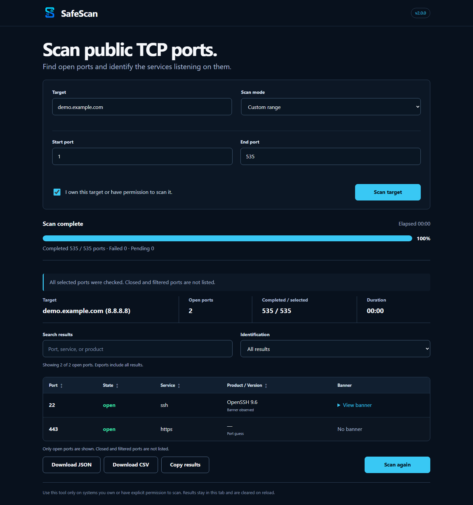
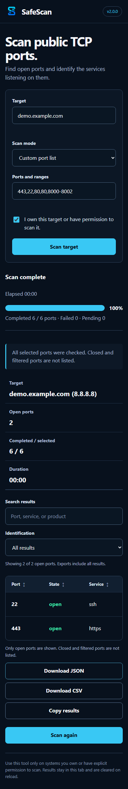

# SafeScan v2.0.0

SafeScan is a stateless public TCP port scanner for authorized checks. The browser divides a selected port range into 250-port chunks, runs three requests concurrently, and renders open ports as they are found. The server performs TCP connect scans and conservative banner-based service identification.

## What's new in 2.0

- Retry unfinished ports after errors or cancellation without repeating completed chunks.
- Custom port lists such as `22,80,443,8000-8100`, deduplicated and sorted; ranges remain available.
- Actual completed, failed and pending port counts, with explicit partial-result status.
- Search by port, service or product and filter banner observations versus port guesses.
- More conservative greeting detection, HTTP Server-header parsing, and MySQL/MariaDB version handling.
- JSON schema version 2 and CSV exports include completion status and coverage. JSON `scanned` now means successfully completed ports; `total` means selected ports. JSON includes per-chunk scope/status and errors. CSV columns have changed to include scan context before service details.
- The header and HTTP `X-SafeScan-Version` expose the release version.

Results and unfinished scope exist only in page memory. Retry works while this tab remains open; reloading or closing it clears everything. Cancellation aborts browser requests; already-admitted server socket work may continue until its bounded timeouts expire. Progress marks a chunk completed only after its successful response and never reaches 100% with unfinished ports. Retry duration accumulates active run time, excluding time spent waiting between runs. Exports always include all discovered results, independent of table filters.

### Interface previews

Screenshots use illustrative, mocked service results; no external target was scanned to create them.





## Run locally

```powershell
python -m venv .venv
.\.venv\Scripts\Activate.ps1
pip install -r requirements.txt
python app.py
```

Open `http://127.0.0.1:5000`.

## API

- `POST /api/resolve` with `{"target":"example.com"}` normalizes and resolves a target once. The complete DNS answer set must contain only public addresses.
- `POST /api/scan` with `{"ip":"...","host":"...","start":1,"end":1000,"authorized":true}` scans at most 2,000 consecutive TCP ports. The server rechecks that the supplied IP is public.
- `GET /health` returns service health.

Scan bounds must be JSON integers (boolean, fractional and string values are rejected). Custom lists are converted into contiguous chunks in the browser, so gaps are never probed and the server repeats all public-IP and range checks.

Both POST endpoints require JSON. CORS is not enabled. Rate limiting is best-effort, in memory, and local to one Vercel function instance. Every request shares one 160-worker pool and at most three chunks may be active per process; saturation returns 503 with Retry-After before allocating work. A separate port budget limits scan cost per client, while allowing a complete 65,535-port scan. Capacity rejections do not consume the port budget. CSV downloads neutralize formula-prefixed text before serialization.

These controls bound each process, not the entire serverless fleet. Configure provider-wide concurrency and spending limits in Vercel for a deployment-wide budget; in-memory quotas do not persist across cold starts or coordinate multiple instances.

The production project's `SafeScan API quota` WAF rule limits `/api/` requests to 600 per 60 seconds per IP before reaching functions. Vercel WAF counters are per edge region, not a single worldwide counter; this is a cross-instance abuse control, not a global spending/concurrency ceiling. See [deployment protection](docs/DEPLOYMENT.md) for exact limits and maintenance steps.

## Scanner settings

The defaults are designed for short-lived Vercel functions:

| Variable | Default | Purpose |
| --- | ---: | --- |
| `SAFESCAN_SCAN_THREADS` | `160` | Total shared TCP worker threads per process |
| `SAFESCAN_MAX_ACTIVE_CHUNKS` | `3` | Maximum admitted chunks per process |
| `SAFESCAN_CONNECT_TIMEOUT` | `0.8` | TCP connect timeout in seconds |
| `SAFESCAN_BANNER_TIMEOUT` | `1.0` | Banner read timeout in seconds |
| `SAFESCAN_RATE_LIMIT_REQUESTS` | `600` | Requests allowed in the in-memory window |
| `SAFESCAN_RATE_LIMIT_PORTS` | `80000` | Ports admitted per client per window |
| `SAFESCAN_RATE_LIMIT_WINDOW` | `60` | Rate-limit window in seconds |

## Security and scope

SafeScan rejects a target when any resolved address is loopback, private, link-local, CGNAT, multicast, reserved, unspecified, IPv6 ULA, or an unsafe IPv4-mapped IPv6 address. Scan requests repeat the public-IP check and connect directly to the approved IP. The scanner sends a small HTTP `HEAD` request only on ports commonly used for HTTP and uses lightweight banner or greeting reads for service identification. It does not perform vulnerability, TLS, CVE, evidence, account, scheduling, or report workflows.

Use SafeScan only on systems you own or have explicit permission to test.

## Tests and quality

```powershell
python -m unittest discover -s tests -v
node --test tests/test_frontend.cjs
ruff check .
black --check .
```

Tests use local listeners and mocks. They never scan external hosts.
